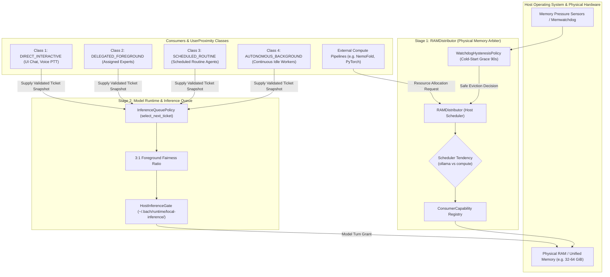
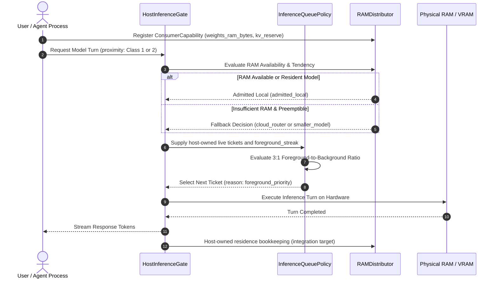

# ocean-resources — RAM Distributor & Model Runtime Scheduler

[](pyproject.toml)
[](.github/workflows/ci.yml)
[](LICENSE)
[](pyproject.toml)
[](tests/)
[](tests/test_metadata.py)
[](llms.txt)

> **Languages / Sprachen:** [English](README.md) | [Deutsch](README_de.md)

Decoupled host resource core for BACH & Ocean (`#2441`, `#1949`, `#2027`, `#2028`, `#2152`, `#2308`–`#2311`, `#2334`, `#2419`):
Unified arbitration of physical host memory (RAM/VRAM), dynamic model residence, and multi-process AI inference scheduling.

---

## Table of Contents / Schnellnavigation

- [<a href="#sec-01">01. Architectural Principle & Two-Stage Claiming</a>](#sec-01)
- [<a href="#sec-02">02. Target Architecture vs. Implementation State</a>](#sec-02)
- [<a href="#sec-03">03. The 4 UserProximity Priority Classes</a>](#sec-03)
- [<a href="#sec-04">04. Visual Architectural Topology & Sequence Diagrams</a>](#sec-04)
- [<a href="#sec-05">05. Practical Usage Recipes (GUI, HTTP API, Python SDK)</a>](#sec-05)
- [<a href="#sec-06">06. Security, Invariants & Level 1 SBOM</a>](#sec-06)
- [<a href="#sec-07">07. Installation & Test Execution</a>](#sec-07)
- [<a href="#sec-08">08. Governance & Contributing</a>](#sec-08)

---

<a id="sec-01"></a>
## 01. Architectural Principle & Two-Stage Claiming

> **Core Principle (Decision 2026-10-24):** No rigid model slots. **Agents are bound directly to models** (`model` + `model_fallbacks`). At runtime, arbitration follows a **two-stage claiming process**:

1. **Stage 1: RAM Claim (`RAMDistributor` / Primary Torch):** Which major consumer (local 27B model vs. scientific compute pipeline vs. media processing job) is allowed to allocate physical RAM/VRAM?
2. **Stage 2: Model Runtime Claim (`Modell-Runtime` / Model Torch):** Which agent or process receives the next inference turn on the resident model — mapped by the host from the **4 UserProximity Classes** to foreground/background tickets, with the conditional **3:1 selection rule (`inference_queue_policy`)**?

---

<a id="sec-02"></a>
## 02. Target Architecture vs. Implementation State (As of 2026-11-14)

| Domain | Target Architecture | Implementation State |
|---|---|---|
| **Stage 1: RAM Distributor (`ram_distributor.py`)** | Single host scheduler for RAM torch, model residence, and compute jobs; consumers declare `ConsumerCapability`; watchdog acts as sensor/actuator with `WatchdogHysteresisPolicy`. | Implemented and verified in `ocean_resources/ram_distributor.py` (`RAMDistributor`, `ConsumerCapability`, `UserProximity`, `DistributorRequest`, `WatchdogHysteresisPolicy`, `FallbackDecision`); bound in `open-ocean` and `bach` via `ocean_stack_bridge.py`. |
| **Stage 2: Model Runtime & Queue (`inference_queue_policy.py` & `HostInferenceGate`)** | Cross-process, fair admission (`select_next_ticket`, 3:1 foreground fairness) with automated fallback chain (`cloud_router`, `smaller_local_model`, `defer_with_checkpoint`). | `select_next_ticket` is a pure selector over a host-supplied snapshot. It owns no queue, process locks, model loading, fallback execution or dispatch. BACH `HostInferenceGate` is an external consumer; its deployment is not verified by this module test suite. |
| **Run cooldown admission (`RunCooldownGate`, PB-26)** | Before each run of a local large consumer the distributor decides whether it may start; under stress the consumer pauses and resumes after the cooldown. | `RunCooldownGate.check()` with read-only `sample_stress()` (`vm_stat` Swapouts, `kern.memorystatus_vm_pressure_level`, `pmset -g therm`): swap-out rate above 32 MiB/min or pressure above normal -> `cooldown:swap`, thermal warning -> `cooldown:thermal`, under 60 s since the run -> `cooldown:min`. A failed probe drops only its own criterion. Defaults in `RunCooldownPolicy`. |
| **Agent-Model Sockets (Decoupled from Slots)** | All agents ("Your Agents") are first-class profiles with direct model bindings (`model` + `model_fallbacks`) and proximity classes 1–4. Legacy `slots` keys in `slots_config.json` remain only for backward storage compatibility. | `model_sockets.py` (`bach.model-sockets.v1`) manages bindings; tray (`ellmos-tray`) and web GUI (`/agenten/running`) expose real-time model bindings and RAM claims. |

---

<a id="sec-03"></a>
## 03. The 4 UserProximity Priority Classes

| Class | Enum (`UserProximity`) | Description | Examples |
|---|---|---|---|
| **Class 1** | `DIRECT_INTERACTIVE = 1` | **Interactive:** The user is actively awaiting a response. Never degraded by background tendencies. | UI chat (`buddha_chat`), `ellmos-talk` voice PTT/duplex, direct terminal prompt |
| **Class 2** | `DELEGATED_FOREGROUND = 2` | **Active User Delegation (Inherited):** Task actively delegated by a Class 1 interaction to an expert or subagent (`inherited_from_proximity`). | Assigned expert subagent, Telegram/Signal connector task (`buddha_connector`) |
| **Class 3** | `SCHEDULED_ROUTINE = 3` | **Scheduled / Periodic:** Due calendar appointment agent or recurring routine maintenance run. | Appointment agent, scheduled code review agent |
| **Class 4** | `AUTONOMOUS_BACKGROUND = 4` | **Background:** Continuous autonomous or idle processing without acute user presence. | `buddha_always_on`, autonomous task master scraper |

---

<a id="sec-04"></a>
## 04. Visual Architectural Topology & Sequence Diagrams

The diagrams illustrate the target host integration, not verified runtime wiring. Queue ownership, admission effects and model operations belong to the consuming host. `QueueTicket` has only foreground/background priority; mapping from four proximity classes belongs to that host.

### System Architecture Topology



### Two-Stage Claiming & Turn Lifecycle



---

<a id="sec-05"></a>
## 05. Practical Usage Recipes (GUI, HTTP API, Python SDK)

### Scenario A: External Process Requires RAM / VRAM (Compute Job, Training, Custom Model)

1. **Via 1-Click in System Tray (`ellmos-tray`) or Web UI (`/agenten/running`):**
   - Tray Menu → **`🔥 RAM-Distributor & Modell-Claim`** → **`🔓 Modell & RAM jetzt für andere Prozesse freigeben (Compute-Vorrang + Unload)`**
   - Sets tendency to `compute`, pauses `buddha_always_on`, and unloads resident Ollama models immediately (`keep_alive: 0`).

2. **Via HTTP API (`:8081` & `:11434`) from Scripts:**
   ```bash
   # 1. Switch tendency in RAM-Distributor to compute priority
   curl -X POST http://127.0.0.1:8081/api/fackel \
     -H "Content-Type: application/json" \
     -d '{"preference": "compute"}'

   # 2. Immediately unload resident Ollama model from VRAM/RAM (keep_alive = 0)
   curl -X POST http://127.0.0.1:11434/api/generate \
     -d '{"model": "qwen3.8:27b-mlx", "keep_alive": 0}'
   ```

3. **Programmatically via `ocean_resources.ram_distributor` (Python):**
   ```python
   from ocean_resources.ram_distributor import (
       ConsumerCapability,
       DistributorRequest,
       RAMDistributor,
       UserProximity,
   )

   dist = RAMDistributor(total_ram_bytes=32 * 1024**3, tendency="compute")
   dist.register_consumer(
       ConsumerCapability(
           consumer_id="nemofold-pipeline",
           kind="compute",
           weights_ram_bytes=18 * 1024**3,
           can_yield_at_turn_boundary=False,
           can_checkpoint=True,
           fallback_chain=("defer_with_checkpoint",),
       )
   )
   decisions = dist.evaluate(
       [DistributorRequest(request_id="req-1", consumer_id="nemofold-pipeline", proximity=UserProximity.DELEGATED_FOREGROUND)],
       available_ram_bytes=24 * 1024**3,
   )
   ```

4. **Via Host Compute Lock (`~/.memwatchdog/compute_active.lock`):**
   Long-running research jobs record their PID in `~/.memwatchdog/compute_active.lock` (`{"active_compute_jobs": [{"pid": 12345, "name": "simulation"}]}`). As long as this lock is active and tendency is `compute`, background workers avoid loading large models.

---

### Scenario B: Process or Agent Claims a Local Model Turn (Model Runtime)

1. **Cooperative Turn Claim via `HostInferenceGate` (Python, Cross-Process):**
   All local processes share `~/.bach/runtime/local-inference/`. With `priority="foreground"` (Class 1/2), your process cooperatively passes background workers (`background`, Class 4) at the next turn boundary:
   ```python
   from hub._services.chat.host_inference_gate import HostInferenceGate

   async with HostInferenceGate().turn("my-agent-process", "foreground"):
       # Exclusive model claim: background workers wait automatically.
       # If the process terminates unexpectedly, OS flock/PID cleanup frees the gate.
       ...
   ```

2. **Direct Foreground Claim via Control API (`:8081/api/chat`):**
   ```bash
   curl -X POST http://127.0.0.1:8081/api/chat \
     -H "Content-Type: application/json" \
     -H "Authorization: Bearer $(cat ~/.credentials/bach_control_api_token)" \
     -d '{"prompt": "Analyze this data...", "chat_id": "my-external-agent"}'
   ```

3. **Rebinding an Agent's Model Socket (Without Rigid Slots):**
   ```bash
   # Via BACH CLI:
   bach model-sockets list --json
   bach model-sockets catalog --json

   # Or via HTTP API:
   curl -X POST http://127.0.0.1:8081/api/slots \
     -H "Content-Type: application/json" \
     -d '{"slot_id": "buddha_chat", "updates": {"model": "qwen3.8:27b-mlx", "backend": "ollama"}}'
   ```

---

<a id="sec-06"></a>
## 06. Security, Invariants & Level 1 SBOM

- **INV-LOCAL-01 (Zero Egress):** Pure local resource arbitration with zero external network dependencies or telemetry calls.
- **INV-LOCAL-02 (Deterministic Turn Scheduling):** When both priorities have valid live tickets, the host preserves `next_foreground_streak`, and `legacy_foreground_pending` is false, the selector chooses a background ticket after at most three consecutive foreground selections. A legacy foreground hold returns no ticket. This is not a wall-clock or end-to-end starvation guarantee.
- **INV-LOCAL-03 (Non-Privileged Execution):** Zero root or administrator privileges required; operates entirely in regular user space.
- **Level 1 SBOM:**
  - `setuptools >= 68.0` (Build system)
  - `pytest` (Test runner)
  - Python Standard Library (`dataclasses`, `typing`, `pathlib`, `json`, `os`, `sys`)
  - License: MIT (SPDX compliant)

---

<a id="sec-07"></a>
## 07. Installation & Test Execution

```bash
# 1. Clone the repository (Plan D canonical clone)
git clone https://github.com/ellmos-ai/ocean-resources.git
cd ocean-resources

# 2. Install editable package with dev tools in an isolated venv
python -m venv .venv
python -m pip install -e ".[dev]"

# 3. Run test suites, linters, and offline CLI smoke checks
python -m pytest
ruff check .
python -m compileall -q ocean_resources tests
python -m ocean_resources manifest
```

### Install with your LLM / Mit deinem LLM installieren

```text
Installiere und verifiziere https://github.com/ellmos-ai/ocean-resources (Release-Tag/Commit-Pin bevorzugen, keine ungeprüften curl|sh-Pipes):
1. Lies zuerst llms.txt und SKILL.md im Repo-Root.
2. Erstelle eine isolierte Umgebung (.venv) und führe den Installationsbefehl aus llms.txt aus.
3. Prüfe die Installation mit dem Verifikationsbefehl (python -m pytest && python -m ocean_resources manifest) und berichte das Ergebnis.
```

---

<a id="sec-08"></a>
## 08. Governance & Contributing

Contributions and issue reports are welcome. Please refer to our [Contributing Guide](CONTRIBUTING.md), [Code of Conduct](CODE_OF_CONDUCT.md), and [Security Policy](SECURITY.md).

## Cooperative host service

The extracted package now includes the owned-process fence dependencies, bounded
external client leases, exact reviewed model API profiles, private host
configuration and an authenticated client CLI. The BACH adapter registers each
local model turn before the existing inference gate and returns resources only
after native exit/model absence and fresh capacity have been verified.

See [the product host contract and activation guide](docs/product-host.md) for
configuration, evidence requirements, CPU checkpoint/resume, TTL and crash
semantics, lock order, supported platforms and deliberate limits. No live host
profile or credential is included.
