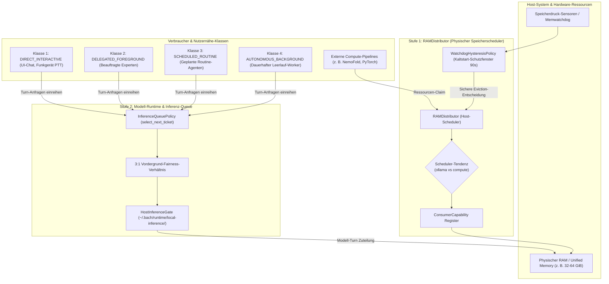
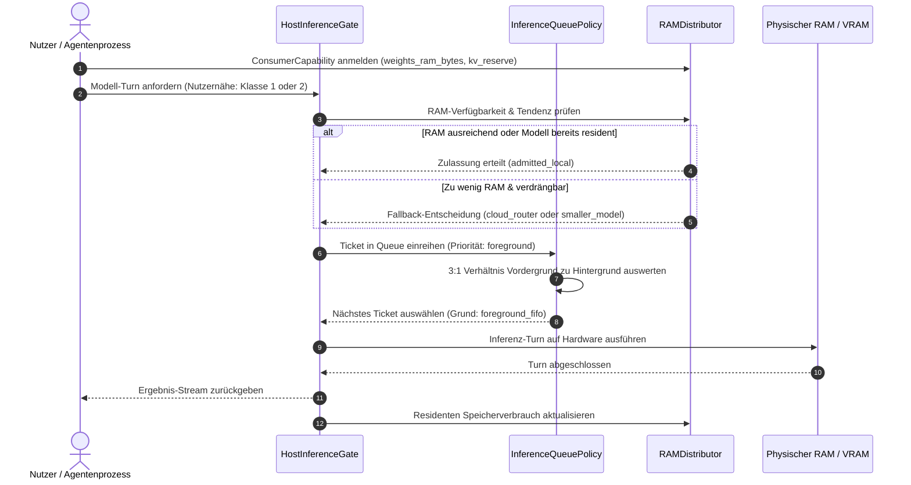

# ocean-resources — RAM-Distributor & Modell-Runtime-Scheduler

[](pyproject.toml)
[](LICENSE)
[](pyproject.toml)
[](tests/)
[](_reg/hosts/WORKSTATION-LG/CHECK-REG.txt)
[](llms.txt)

> **Sprachen / Languages:** [Deutsch](README_de.md) | [English](README.md)

Herausgelöstes Ocean-Ressourcenmodul (`#2441`, `#1949`, `#2027`, `#2028`, `#2152`, `#2308`–`#2311`, `#2334`, `#2419`):
Einheitliche Koordination von physischem Host-Arbeitsspeicher (RAM/VRAM), dynamischer Modell-Residenz und prozessübergreifender KI-Inferenz-Arbitrierung.

---

## Schnellnavigation / Table of Contents

- [<a href="#sec-01">01. Architektur-Grundsatz & Zweistufiges Claiming</a>](#sec-01)
- [<a href="#sec-02">02. SOLL-Stand vs. IST-Stand</a>](#sec-02)
- [<a href="#sec-03">03. Die 4 Prioritätsklassen nach Nutzernähe (UserProximity)</a>](#sec-03)
- [<a href="#sec-04">04. Visuelle Architektur-Topologie & Sequenzdiagramme</a>](#sec-04)
- [<a href="#sec-05">05. Praxis-Rezepte (GUI, HTTP API, Python)</a>](#sec-05)
- [<a href="#sec-06">06. Sicherheit, Invarianten & Level 1 SBOM</a>](#sec-06)
- [<a href="#sec-07">07. Installation & Testausführung</a>](#sec-07)
- [<a href="#sec-08">08. Governance & Mitwirken</a>](#sec-08)

---

<a id="sec-01"></a>
## 01. Architektur-Grundsatz & Zweistufiges Claiming

> **Grundsatz (Entscheidung 24.10.2026):** Keine starren Modell-Slots mehr. **Agenten sind direkt an Modelle gebunden** (`model` + `model_fallbacks`). Zur Laufzeit erfolgt ein **zweistufiges Claiming**:

1. **Stufe 1: RAM-Claim (`RAMDistributor` / Hauptfackel):** Welcher Großverbraucher (lokales 27B-Modell vs. wissenschaftliche Compute-Pipeline vs. Media-Job) darf physischen RAM/VRAM belegen?
2. **Stufe 2: Modell-Runtime-Claim (`Modell-Runtime` / Modellfackel):** Welcher Agent oder Prozess erhält den nächsten Inferenz-Turn auf dem geladenen Modell – streng nach den **4 Nutzernähe-Klassen (`UserProximity`)** und **3:1 Foreground-Fairness (`inference_queue_policy`)**?

---

<a id="sec-02"></a>
## 02. SOLL-Stand vs. IST-Stand (Stand 04.11.2026)

| Bereich | SOLL-Stand (Zielarchitektur) | Belegter IST-Stand |
|---|---|---|
| **Stufe 1: RAM-Distributor (`ram_distributor.py`)** | Einziger Host-Scheduler für RAM-Fackel, Modell-Residenz und Compute-Jobs; Verbraucher melden `ConsumerCapability`; Watchdog ist reiner Sensor/Aktor mit `WatchdogHysteresisPolicy`. | Implementiert & getestet in `ocean_resources/ram_distributor.py` (`RAMDistributor`, `ConsumerCapability`, `UserProximity`, `DistributorRequest`, `WatchdogHysteresisPolicy`, `FallbackDecision`); über `ocean_stack_bridge.py` in `open-ocean` und `bach` gebunden (`bound: true`). |
| **Stufe 2: Modell-Runtime & Queue (`inference_queue_policy.py` & `HostInferenceGate`)** | Prozessübergreifende, faire Zulassung (`select_next_ticket`, 3:1 Foreground-Fairness) + automatische Fallback-Kette (`cloud_router`, `smaller_local_model`, `defer_with_checkpoint`). | `ocean_resources/inference_queue_policy.py` (`select_next_ticket`) und `bach/system/hub/_services/chat/host_inference_gate.py` (`HostInferenceGate` unter `~/.bach/runtime/local-inference/`) produktiv aktiv. |
| **Agenten-Modell-Bindung (statt alter Slots)** | Alle Agenten („Deine Agenten") sind gleichberechtigte Profile mit Modellbindung (`model` + `model_fallbacks`) und Nutzernähe-Klasse 1–4. Historischer Schlüssel `slots` in `slots_config.json` dient nur der Speicher-Abwärtskompatibilität. | `model_sockets.py` (`bach.model-sockets.v1`) projiziert und verwaltet Agenten-Modell-Bindungen; Tray (`ellmos-tray`) und GUI (`/agenten/running`) zeigen **„🤖 Deine Agenten (Modell-Bindung)"** und **„🔥 RAM-Distributor & Modell-Claim"**. |

---

<a id="sec-03"></a>
## 03. Die 4 Prioritätsklassen nach Nutzernähe (`UserProximity`)

| Klasse | Enum (`UserProximity`) | Bedeutung | Beispiele |
|---|---|---|---|
| **Klasse 1** | `DIRECT_INTERACTIVE = 1` | **Interaktiv:** Der Nutzer wartet gerade direkt auf Antwort. Wird niemals durch die Tray-Tendenz herabgestuft. | GUI-Chat (`buddha_chat`), `ellmos-talk` Funkgerät (PTT/Duplex), direkte Konsolenanfrage |
| **Klasse 2** | `DELEGATED_FOREGROUND = 2` | **Aktiver Nutzerauftrag (vererbt):** Vom Klasse-1-Chat oder Nutzer aktiv an einen Experten/Subagenten delegierter Auftrag (`inherited_from_proximity`). | Beauftragter Experte, Telegram/Signal-Connector-Auftrag (`buddha_connector`) |
| **Klasse 3** | `SCHEDULED_ROUTINE = 3` | **Geplant / Terminiert:** Fälliger Kalender-Terminagent oder wiederkehrender Routine-Agent. | Terminagent, geplanter Review-Lauf |
| **Klasse 4** | `AUTONOMOUS_BACKGROUND = 4` | **Hintergrund:** Autonome Dauer- oder Leerlaufarbeit ohne akuten Nutzerbezug. | `buddha_always_on`, autonome Task-Master-Abfrage |

---

<a id="sec-04"></a>
## 04. Visuelle Architektur-Topologie & Sequenzdiagramme

### System-Architektur Topologie



### Zweistufiger Claiming- & Ausführungs-Lebenszyklus



---

<a id="sec-05"></a>
## 05. Praxis-Rezepte (GUI, HTTP API, Python)

### Fall A: Externer Prozess braucht RAM / VRAM (Compute-Job, Training, eigenes Modell)

1. **Per 1-Klick im System-Tray (`ellmos-tray`) oder in der GUI (`/agenten/running`):**
   - Tray-Menü → **`🔥 RAM-Distributor & Modell-Claim`** → **`🔓 Modell & RAM jetzt für andere Prozesse freigeben (Compute-Vorrang + Unload)`**
   - Schaltet die Tendenz auf `compute`, pausiert `buddha_always_on` und entlädt das aktive Ollama-Modell sofort (`keep_alive: 0`).

2. **Per HTTP-API (`:8081` & `:11434`) aus beliebigen Skripten:**
   ```bash
   # 1. Tendenz im RAM-Distributor auf Compute-Vorrang setzen
   curl -X POST http://127.0.0.1:8081/api/fackel \
     -H "Content-Type: application/json" \
     -d '{"preference": "compute"}'

   # 2. Geladenes Ollama-Modell sofort aus dem VRAM/RAM entladen (keep_alive = 0)
   curl -X POST http://127.0.0.1:11434/api/generate \
     -d '{"model": "qwen3.8:27b-mlx", "keep_alive": 0}'
   ```

3. **Programmatisch über `ocean_resources.ram_distributor` (Python):**
   ```python
   from ocean_resources.ram_distributor import (
       ConsumerCapability,
       DistributorRequest,
       RAMDistributor,
       UserProximity,
   )

   dist = RAMDistributor(total_ram_bytes=32 * 1024**3, tendency="compute")
   dist.register_consumer(
       ConsumerCapability(
           consumer_id="nemofold-pipeline",
           kind="compute",
           weights_ram_bytes=18 * 1024**3,
           can_yield_at_turn_boundary=False,
           can_checkpoint=True,
           fallback_chain=("defer_with_checkpoint",),
       )
   )
   decisions = dist.evaluate(
       [DistributorRequest(request_id="req-1", consumer_id="nemofold-pipeline", proximity=UserProximity.DELEGATED_FOREGROUND)],
       available_ram_bytes=24 * 1024**3,
   )
   ```

4. **Über den Host-Compute-Lock (`~/.memwatchdog/compute_active.lock`):**
   Langlaufende Forschungs-/Compute-Jobs tragen ihre PID in `~/.memwatchdog/compute_active.lock` ein (`{"active_compute_jobs": [{"pid": 12345, "name": "simulation"}]}`). Solange dieser Lock aktiv ist und die Tendenz auf `compute` steht, startet der Hintergrund-Worker keine Modell-Loads.

---

### Fall B: Prozess oder Agent will ein lokales Modell nutzen / claimen (Modell-Runtime)

1. **Kooperativer Turn-Claim über `HostInferenceGate` (Python, prozessübergreifend):**
   Alle lokalen Prozesse auf dem Host teilen sich `~/.bach/runtime/local-inference/`. Mit `priority="foreground"` (Klasse 1/2) überholt dein Prozess laufende Hintergrund-Worker (`background`, Klasse 4) automatisch an der nächsten sicheren Turn-Grenze:
   ```python
   from hub._services.chat.host_inference_gate import HostInferenceGate

   async with HostInferenceGate().turn("mein-agent-prozess", "foreground"):
       # Exklusiver Modell-Claim: Hintergrund-Worker warten automatisch.
       # Stürzt der Prozess ab, gibt der OS-Flock/PID-Check das Gate sofort frei.
       ...
   ```

2. **Direkter Modell-Aufruf mit Vordergrund-Claim über die Control API (`:8081/api/chat`):**
   ```bash
   curl -X POST http://127.0.0.1:8081/api/chat \
     -H "Content-Type: application/json" \
     -H "Authorization: Bearer $(cat ~/.credentials/bach_control_api_token)" \
     -d '{"prompt": "Analysiere diesen Befund...", "chat_id": "mein-externer-agent"}'
   ```

3. **Modell-Bindung eines Agenten umstellen (ohne starre Slots):**
   ```bash
   # Über die BACH-CLI:
   bach model-sockets list --json
   bach model-sockets catalog --json

   # Oder per HTTP-API (Agentenprofil auf anderes Modell umbinden):
   curl -X POST http://127.0.0.1:8081/api/slots \
     -H "Content-Type: application/json" \
     -d '{"slot_id": "buddha_chat", "updates": {"model": "qwen3.8:27b-mlx", "backend": "ollama"}}'
   ```

---

<a id="sec-06"></a>
## 06. Sicherheit, Invarianten & Level 1 SBOM

- **INV-LOCAL-01 (Zero Egress):** Reines lokales Scheduling ohne externe Netzwerk-Egress-Abhängigkeiten.
- **INV-LOCAL-02 (Deterministische Queue-Auswahl):** Mathematisch beweisbare 3:1 Vordergrund-Fairness verhindert Starvation von Hintergrund-Workern.
- **INV-LOCAL-03 (Unprivilegierte Ausführung):** Keine Administrator- oder Root-Rechte erforderlich; Ausführung erfolgt im unprivilegierten Benutzerkontext.
- **Level 1 SBOM:**
  - `setuptools >= 68.0` (Build-System)
  - `pytest` (Test-Laufzeit)
  - Python Standard Library (`dataclasses`, `typing`, `pathlib`, `json`, `os`, `sys`)
  - Lizenz: MIT (SPDX-konform)

---

<a id="sec-07"></a>
## 07. Installation & Testausführung

```bash
# 1. Repository klonen (Plan D kanonischer Klon)
git clone https://github.com/ellmos-ai/ocean-resources.git
cd ocean-resources

# 2. Entwicklungsumgebung & Tests ausführen
python -m pytest
ruff check .
python -m compileall .
```

---

<a id="sec-08"></a>
## 08. Governance & Mitwirken

Beiträge und Fehlerberichte sind herzlich willkommen. Bitte beachten Sie unsere [Beitragsrichtlinie](CONTRIBUTING.md), den [Verhaltenskodex](CODE_OF_CONDUCT.md) sowie die [Sicherheitsrichtlinie](SECURITY.md).
